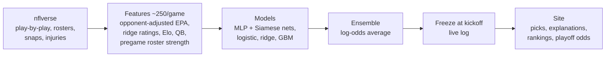

# NFL Predictor

[](https://github.com/KrishKalra19/nfl-predictor/actions/workflows/ci.yml)
[](https://krishkalra19.github.io/nfl-predictor/)

A neural-network ensemble that predicts **NFL win probabilities** using only information available
before kickoff. It retrains itself weekly, freezes every prediction at kickoff, and publishes picks,
a live track record, power rankings and playoff odds to **[the site](https://krishkalra19.github.io/nfl-predictor/)**.
Vegas lines are a benchmark, never an input.

## Results

Walk-forward backtest: each season is predicted by models trained only on earlier seasons. All tuning
used 2018–21; the 2022–26 games were scored once, after the lineup was locked.

| Held-out 2022–26 (1,218 games) | Accuracy | Log-loss |
|---|---|---|
| **Ensemble (this project)** | **66.2%** | **0.624** |
| MLP neural net | 66.8% | 0.625 |
| Vegas moneyline | 67.4% | 0.610 |
| Elo rating | 63.9% | 0.635 |
| Always pick home team | 55.0% | 0.688 |

Confidence is calibrated: held-out picks made at 75%+ confidence won about 81% of the time.
Every 2026 prediction since launch is also logged, frozen at kickoff, in
[`docs/data/live_log.csv`](docs/data/live_log.csv).

## How it works



- **Features:**
  - Short- and long-window form with opponent adjustment, ridge power ratings and Elo.
  - A shrunk QB EPA rating that carries across teams and seasons, plus QB-change flags.
  - Roster strength from player snap share and draft capital over the *pregame* active roster, with missing starters counted against the team.
  - Rest, travel and body clock.
- **Models:**
  - An MLP with a linear skip path, and a Siamese matchup network with a shared team encoder. Both are multi-task (win logit + point margin), heavily L2-regularized and 8-seed ensembles.
  - Logistic regression, ridge-margin and gradient boosting complete the ensemble.
  - Every game is trained from both sides, so predictions are symmetric.
- **Explanations:** the linear member splits each prediction exactly into grouped feature contributions ("Grounds" on the site).
- **Ratings and playoff odds:**
  - A Kalman filter gives each team a rating with uncertainty.
  - 10,000 Monte Carlo season simulations give playoff, division and #1-seed odds.

## Keeping it honest

- **Pregame features only.** Every feature is computed as of kickoff. `tests/test_leakage.py` checks this on a synthetic league: features for a week must be identical whether or not later results exist. Those tests caught (and fixed) a subtle leak of whole-dataset league averages into early-season priors; see REPORT.md.
- **Same roster view in testing and live.** A player is available if he's on the 53-man roster and not listed Out or Doubtful on Friday. Game-day inactives were never used in training.
- **Frozen predictions.** Live predictions train only on earlier weeks and freeze at kickoff (`tests/test_freeze.py`).
- **Measured experiments.** Many ideas didn't make the cut, and [LOOP_LOG.md](LOOP_LOG.md) records each with its numbers: weather, coaching, kicking, Kalman features, QB age, calibration, stacking, a GRU sequence model and per-player production ratings.

## Run it

```bash
pip install torch --index-url https://download.pytorch.org/whl/cpu
pip install -r requirements.txt
python src/download_data.py         # ~450 MB from nflverse
python src/run_weekly.py            # rebuild features, retrain, predict the next week
python src/build_site.py            # rebuild docs/ (site, live log, rankings, playoff odds)
pytest                              # leakage, symmetry and freeze tests
```

Backtests: `python src/evaluate.py --phase dev|test`, then `python src/export_results.py`.

## Code map (`src/`)

| File | Role |
|---|---|
| `download_data.py` | nflverse schedules, play-by-play, weekly rosters, snap counts, depth charts, injuries, player IDs |
| `team_games.py` | Per-team per-game stats from play-by-play, plus QB game logs |
| `players.py` | Player ratings and pregame roster strength by unit, including missing regulars |
| `build_features.py` | The game-level feature table (form, ratings, Elo, QB, stakes, rest/travel, Vegas benchmark) |
| `kalman.py` | State-space team ratings with uncertainty |
| `dataset.py`, `models.py`, `config.py` | Symmetric matchup matrices, the five models, the final lineup |
| `backtest.py`, `evaluate.py`, `export_results.py` | Walk-forward evaluation and site result exports |
| `experiments.py`, `exp_features.py`, `exp_calibration.py` | Experiment grids and A/B harness |
| `predict.py`, `explain.py`, `run_weekly.py` | Weekly predictions, frozen at kickoff, with explanations |
| `live_log.py`, `playoffs.py`, `build_site.py`, `pick_sheet.py` | Live record, playoff simulation, site and pick-sheet builders |

More: [REPORT.md](REPORT.md) (findings), [MODEL_CARD.md](MODEL_CARD.md), [LOOP_LOG.md](LOOP_LOG.md) (experiment log).
